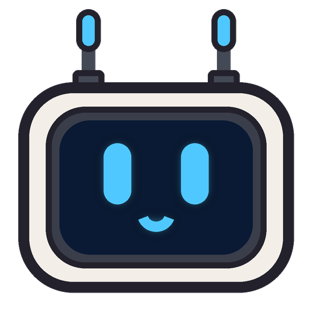

<p align="center">
  
</p>

<h1 align="center">Pip</h1>

<p align="center">A happy little CRT head that floats around your desktop.</p>

---

Pip hovers on a holo ring, glides around your screen, turns to side profile as he
flies, follows your cursor with his eyes and talks in glowing speech bubbles. He
stays out of your way: clicks go straight through to whatever is behind him
unless your mouse is actually on Pip.

## What Pip can do

- **Floats** on a pulsing holo ring and **glides** around, turning to side profile as he moves and leaning into turns, with a sparkle trail
- **10 expressions**: happy, excited, curious, sleepy, surprised, wink, silly, sad, angry and hearts
- **Glowing antennas** that change color with his mood
- **Watches your cursor** with his CRT eyes
- **Talks** in speech bubbles (greetings, idle chatter, bedtime nags)
- **Get booped**: click him. Click him too much and he gets grumpy
- **Get thrown**: drag him and let go. He flies, bonks off the screen edges and steadies himself
- **Head pats**: rub your mouse back and forth over his head
- **Gets lonely**, then **naps**, if you ignore him for a few minutes (hover to wake him)
- **Shortcut**: `Ctrl + Alt + P` (`Cmd + Alt + P` on Mac) hides/shows Pip

## Customize him from the tray

- **Color**: Classic (ivory), Neon (purple), Retro (green), Midnight (black)
- **Glow color**: blue, cyan, pink, green, amber, purple
- **Antennas**: glow tubes or round bulbs
- **Size**: small, medium, large
- **Stickers** and **Ambient light** on/off
- **Let Pip roam**, **Roam area** (bottom of screen or anywhere), **Call Pip over**
- **Speech bubbles**, **Start with computer**

## Run it yourself

You need [Node.js](https://nodejs.org) (the LTS version).

```bash
npm install
npm start
```

## Build an installer

```bash
npm run dist:win     # Windows .exe installer
npm run dist:mac     # macOS .zip (run this on a Mac)
npm run dist:linux   # Linux AppImage
```

